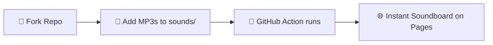
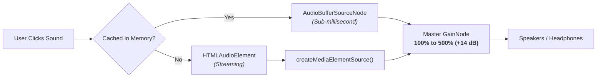

<div align="center">

  

  # WebSoundboard

  <p>A fast, phone-friendly meme soundboard you can customize, fork, and make completely your own.</p>

  <p>
    <a href="https://pepe-pl.github.io/WebSoundboard/">
      
    </a>
  </p>

  <p>
    <a href="https://github.com/Pepe-PL/WebSoundboard/stargazers"></a>
    <a href="https://github.com/Pepe-PL/WebSoundboard/network/members"></a>
    <a href="LICENSE"></a>
    <a href="https://pages.github.com/"></a>
  </p>

</div>

---

## ⚡ Highlights & Key Features

<table>
  <tr>
    <td width="50%">
      <h3>🚀 Pure Vanilla Performance</h3>
      <p>Written in zero-dependency Vanilla JS, HTML5, and CSS3. Loads instantly, runs smooth on any mobile device or desktop browser.</p>
    </td>
    <td width="50%">
      <h3>📢 Extreme Volume Boost (100%–500%)</h3>
      <p>Powered by the <b>Web Audio API</b> <code>GainNode</code>. Can boost quiet memes up to <b>5× original amplitude</b> (+14 dB) without browser volume clipping limits.</p>
    </td>
  </tr>
  <tr>
    <td width="50%">
      <h3>📱 Native PWA App Feel</h3>
      <p>Installable directly to iOS & Android homescreens via <b>Progressive Web App (PWA)</b>. Fully functional offline playback for cached sounds.</p>
    </td>
    <td width="50%">
      <h3>🎨 Custom Color Categories & Favorites</h3>
      <p>Group clips into customizable categories with full color-picker customization, custom order management, and quick-filter tabs.</p>
    </td>
  </tr>
  <tr>
    <td width="50%">
      <h3>🔍 Instant Search & Shortcuts</h3>
      <p>Search any clip on the fly by pressing <kbd>/</kbd>. Fast keyboard navigation and responsive sound cards with live playback indicators.</p>
    </td>
    <td width="50%">
      <h3>🤖 Auto-Updating Sounds Pipeline</h3>
      <p>Powered by GitHub Actions — just drop audio files into <code>sounds/</code> and push. Manifests generate automatically.</p>
    </td>
  </tr>
</table>

---

## 🎧 Supported Audio Formats

<table>
  <tr>
    <th width="50%">Audio Codecs & Extensions</th>
    <th width="50%">Smart Naming & File Specs</th>
  </tr>
  <tr>
    <td valign="top">
      <table>
        <tr>
          <th>Format</th>
          <th>Extension</th>
          <th>Support</th>
        </tr>
        <tr>
          <td><b>MPEG Audio</b></td>
          <td><code>.mp3</code></td>
          <td>Universal</td>
        </tr>
        <tr>
          <td><b>Waveform</b></td>
          <td><code>.wav</code></td>
          <td>Universal (Lossless)</td>
        </tr>
        <tr>
          <td><b>Ogg Vorbis</b></td>
          <td><code>.ogg</code>, <code>.oga</code></td>
          <td>Android & Desktop</td>
        </tr>
        <tr>
          <td><b>AAC / MP4</b></td>
          <td><code>.m4a</code>, <code>.aac</code></td>
          <td>iOS & Modern Web</td>
        </tr>
      </table>
    </td>
    <td valign="top">
      <p><b>✨ Automatic Label Formatting</b><br />
      Filenames like <code>what-the-dog-doin.mp3</code> or <code>meme_sound_01.wav</code> are automatically converted into neat, clean button labels: <code>what the dog doin</code>.</p>
      <p><b>🌐 Full UTF-8 & Emoji Support</b><br />
      Spaces, accents, dashes, Polish diacritics (<code>ą</code>, <code>ę</code>, <code>ł</code>), and emojis in filenames work right out of the box.</p>
      <p><b>⚡ Background Audio Pre-loading</b><br />
      Audio files are loaded asynchronously and decoded in memory for instantaneous zero-latency playback.</p>
    </td>
  </tr>
</table>

---

## 🚀 Quick Start — Create Your Own Soundboard in 2 Minutes

You don't need to know coding to deploy your own version:



1. **Fork the repository**  
   Click the [**Fork**](https://github.com/Pepe-PL/WebSoundboard/fork) button in the upper-right corner of this repo.
2. **Add your sound clips**  
   Upload your favourite audio files directly into the `sounds/` directory (via GitHub web upload or Git push).
3. **Turn on GitHub Actions & Pages**
   - Head over to **Settings** → **Actions** → **General** → set **Workflow permissions** to `Read and write permissions`.
   - Go to **Settings** → **Pages** → choose `Deploy from a branch` → Select `main` and root `/`.
4. **Enjoy your Soundboard!**  
   Your custom soundboard is live at `https://<YOUR-USERNAME>.github.io/<YOUR-REPO>/`.

---

## 🎛️ How the Audio Engine Works

WebSoundboard combines instantaneous memory playback with smooth streaming fallback into a single unified master stage:



- **Prebuffered Mode:** On library load, high-priority clips are decoded into raw memory buffers via Web Audio API for sub-millisecond trigger latency.
- **Dynamic Gain Master:** The master slider adjusts amplitude smoothly using `setTargetAtTime`, avoiding pops and distortion clicks.

---

## 💻 Local Development

No Node build steps or bundling needed. Run any simple static file server from the root directory:

```bash
# Using Python
python -m http.server 8080

# Or using Node.js
npx serve .

# Or using PHP
php -S localhost:8080
```

Then visit: [**http://localhost:8080**](http://localhost:8080)

---

## 📱 Mobile Installation (PWA)

- **iOS (Safari):** Open the soundboard link, tap the **Share** button, then tap **Add to Home Screen**.
- **Android (Chrome):** Tap the **⋮** menu button in Chrome and select **Install app** or **Add to Home Screen**.

---

<div align="center">

  Made with ❤️ by [**Pepe-PL**](https://github.com/Pepe-PL)  
  *Feel free to star ⭐ the repo if you like it!*

</div>
